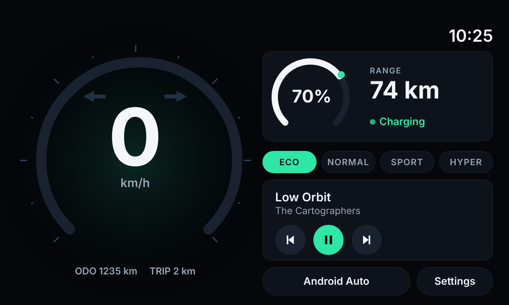
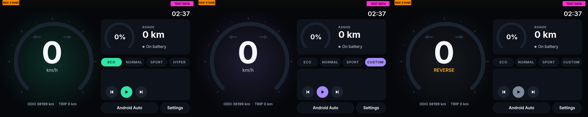

# Ola Dash SDK

An unofficial, open-source dash platform for the Ola S1 Pro Gen 1 electric scooter. It replaces the stock 640 MB dash with a roughly 70 MB [Slint](https://slint.dev) app whose look comes from `.slint` theme files loaded at runtime, so a theme can be changed without rebuilding the app. Plugins are separate Android APKs that publish data into named slots, and the owner decides which of them run. The host, not the theme or a plugin, owns every safety-relevant screen element.

[](https://github.com/abhi245y/ola-dash-sdk/actions/workflows/ci.yml)

> [!WARNING]
> **Work in progress: early build (0.1, experimental).** Anything can change between commits: the theme contract, the plugin API, file layouts, build steps and behaviour on the scooter. There are no stability guarantees until 1.0, so pin a commit if you build on top of it. The host is in field testing on a rooted scooter owned by the maintainer. Themes can be developed and checked without a scooter. Expect rough edges.

**This project is not affiliated with, endorsed by, or supported by Ola Electric.** See the [disclaimer](#disclaimer).





## Features

- **Runtime themes.** A theme is a folder with a `main.slint` and a `theme.json`. `slint-interpreter` loads it at runtime. No Rust code or rebuild is needed.
- **A small, versioned contract.** Themes see only `contract/vehicle.slint`: read-only vehicle, battery, ride, media and navigation values, plus a few harmless callbacks. The contract is additive-only (see [docs/contract.md](docs/contract.md)).
- **Host-owned safety overlay.** Telltales, alerts and the passcode/unlock screens are drawn above every theme and cannot be hidden by one.
- **No vehicle commands from themes or plugins.** Themes and plugins are display-only.
- **Desktop preview.** `sim` renders any theme with mock data, either in a window or as a deterministic PNG, so themes can be designed without a scooter.
- **Keep-alive and logging.** The host keeps the vehicle-parser service awake the way the stock HMI does, and writes session logs of every vehicle callback and raw CAN traffic for analysis.
- **Plugins (API v1).** Owner-enabled APKs publish value widgets, media and turn-by-turn data. The host also has a built-in media source. See [docs/plugins.md](docs/plugins.md) and the [example plugin](plugins/example-sysinfo/README.md).
- **Optional unlock module.** Passcode entry through the stock profile service, using the owner's existing passcode. It bypasses nothing.

## Architecture

```
 Ola vehicle-parser service (stock, on the head unit)
        |  AIDL callbacks (clean-room interface, sdk/vehicle-interface)
        v
 VehicleBridge (Java)           keep-alive, session logs, debug test channel
        |  JNI
        v
 Rust host (Slint runtime, liboladash.so)
   |- theme loader    themes/<id>/main.slint  -> Vehicle, Battery, Ride, Media, Navigation, Plugins
   |- safety overlay  host/ui/overlay.slint   always drawn above the theme
   '- plugin host     owner-enabled  <-- IDashHost / IDashPlugin --> plugin APKs
```

More detail: [docs/architecture.md](docs/architecture.md).

## Quick start

### Preview a theme without a scooter

You need a recent stable Rust toolchain and the fontconfig development files (`fontconfig-devel` on Fedora, `libfontconfig1-dev` on Debian and Ubuntu).

```sh
# Live window with mock data (needs a display)
cargo run --release --manifest-path sim/Cargo.toml -- themes/default

# Headless PNG at sim time 75 s (sim/out/ is git-ignored)
mkdir -p sim/out
cargo run --release --manifest-path sim/Cargo.toml -- themes/default --screenshot sim/out/default-t75.png --at 75

# Validate every theme (theme.json + full compile)
tools/check-themes.sh
```

### Build the Android host

The host builds from a clean checkout. It talks to the stock vehicle service through clean-room interface definitions in [sdk/vehicle-interface/](sdk/vehicle-interface/), written from an interoperability spec rather than copied from Ola's software. Full steps: [docs/building.md](docs/building.md).

## Project layout

```
contract/            theme contract (the only API themes see)
host/                Android host: Rust + Slint, Java bridge, safety overlay
sdk/plugin-api/      plugin API v1 (AIDL)
plugins/            example plugin (`example-sysinfo`)
themes/              bundled themes: default, minimal
sim/                 desktop mock-data runner (preview and --check)
tools/               check-themes.sh and other helpers
docs/                documentation, screenshots (docs/img)
.github/             CI, issue and PR templates
```

## Documentation

| Document | What it covers |
|---|---|
| [architecture.md](docs/architecture.md) | Components, data flow, keep-alive, logging, home-screen swap |
| [contract.md](docs/contract.md) | Every global, field and enum in the theme contract, with units and versioning rules |
| [themes.md](docs/themes.md) | Writing a theme, `theme.json`, size budget, renderer limits |
| [plugins.md](docs/plugins.md) | Plugin API v1: enablement, media listener grant, limits, lifecycle |
| [building.md](docs/building.md) | Toolchain, build, install, uninstall |
| [testing.md](docs/testing.md) | Sim screenshots, theme checks, test channel, logs |
| [safety.md](docs/safety.md) | Safety model and rules for owners and contributors |
| [roadmap.md](docs/roadmap.md) | What is planned and what is not |
| [related-projects.md](docs/related-projects.md) | Other open Ola scooter projects (add yours with a PR) |
| [CONTRIBUTING.md](CONTRIBUTING.md) | How to contribute, PR checklist |
| [CHANGELOG.md](CHANGELOG.md) | Release history |
| [SECURITY.md](SECURITY.md) | Reporting vulnerabilities |

## Safety

Read [docs/safety.md](docs/safety.md) before installing anything. In short: the safety overlay cannot be hidden, themes and plugins cannot command the vehicle, the test channel exists only in debug builds and shows a TEST DATA banner, and this software is experimental. Do not use the dash for anything beyond glanceable information while riding.

## Disclaimer

Ola Dash SDK is an unofficial, community project. It is not affiliated with, authorized by, sponsored by, or endorsed by Ola Electric. "Ola" and "S1" are trademarks of Ola Electric, used only to describe compatibility. Installing the host replaces the stock home screen on a scooter you own and may affect its warranty. You use this software at your own risk. Riding with experimental software is your responsibility.

## License

Ola Dash SDK is free software under the [GNU General Public License v3.0 or later](LICENSE). The GPL is required here because Slint's open-source license is GPL. Bundled fonts (Inter) are under the SIL Open Font License 1.1, see `themes/default/fonts/LICENSE-OFL.txt`.
