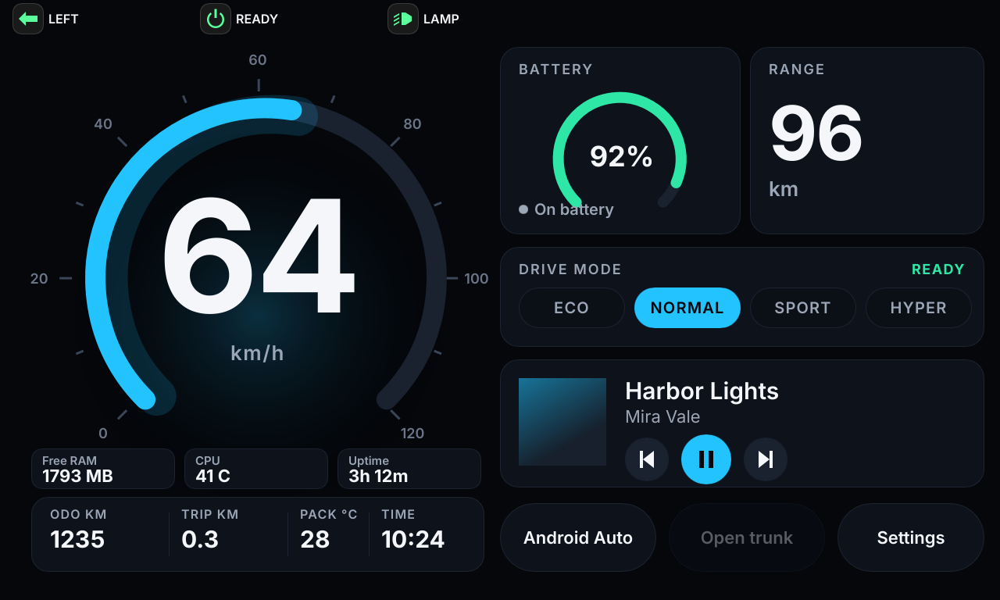
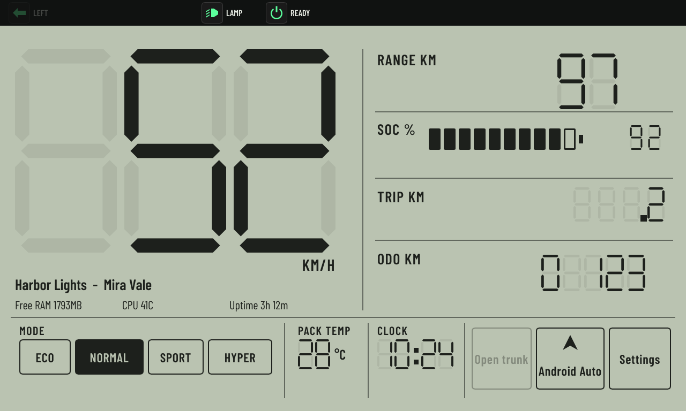
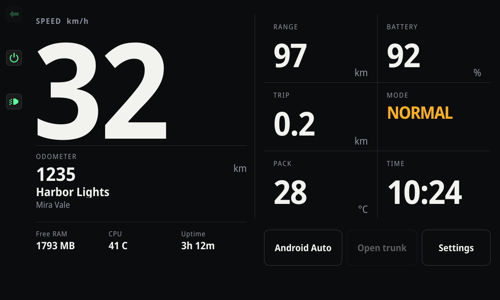
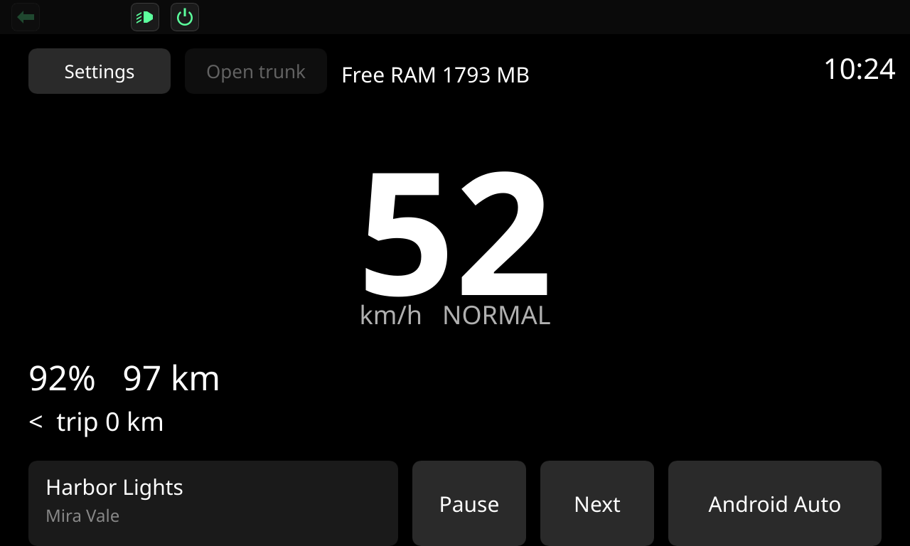
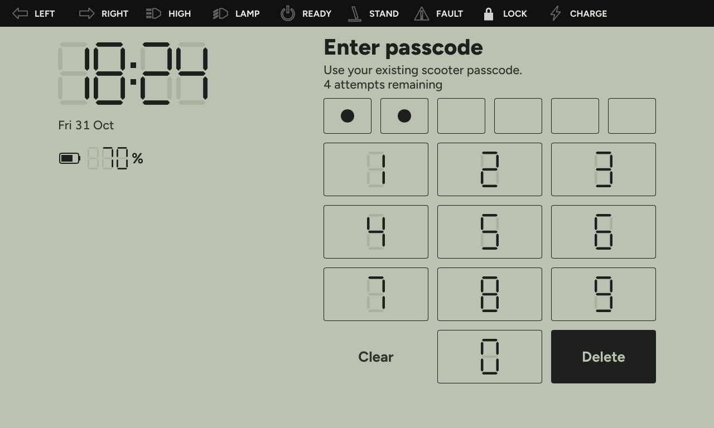
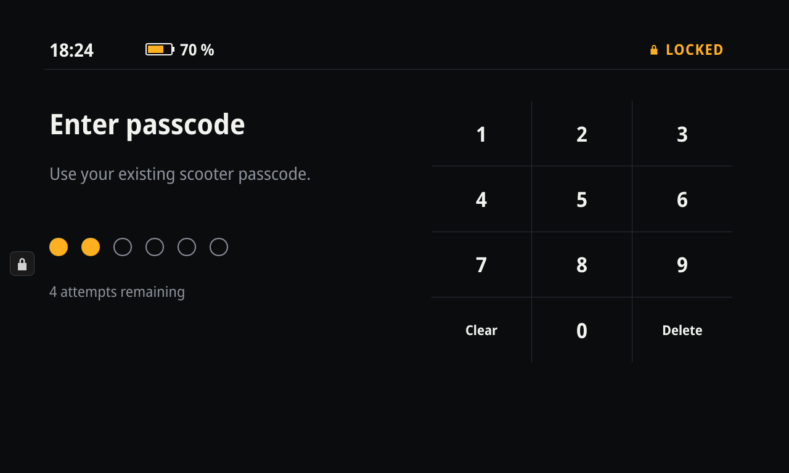
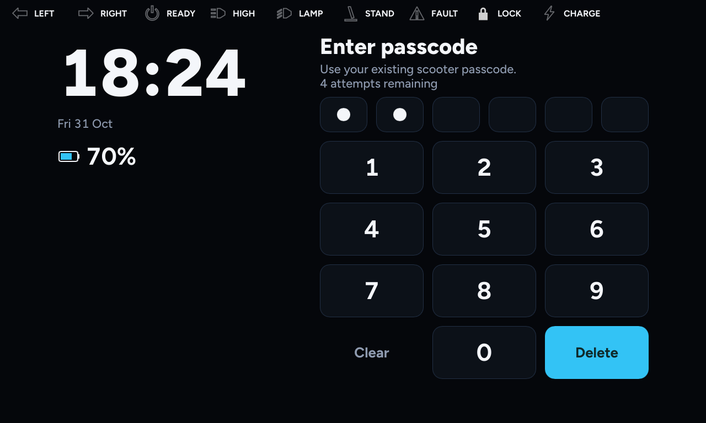
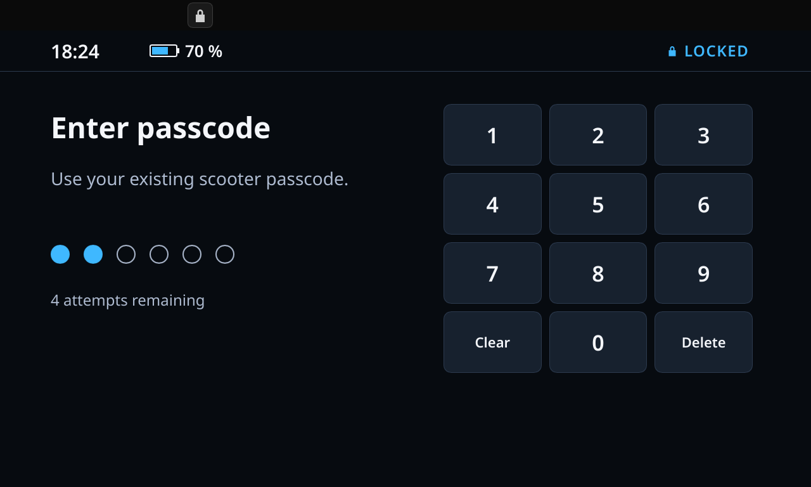

# Themes

A theme is a folder `themes/<id>/` with a `main.slint` entry point and a `theme.json` manifest. The host loads it at runtime with `slint-interpreter`, so a theme needs no Rust code and no rebuild.

The repository ships four themes. Three are **reference themes**: each matches an approved design and shows patterns you can copy. The fourth, `minimal`, is the smallest working example.

Read [contract.md](contract.md) first. Themes see only that API.

## Reference themes

Every reference theme handles the same states (see [States every theme handles](#states-every-theme-handles)). The captures below come from `sim`: park, riding, charging, a side-stand alert and trunk open. Minimal has one riding capture.

### Default: `themes/default/`



The modern EV dash at full craft: dark glass cards, an arc speedometer with a battery ring, mode pills, a media card and a trunk key. Telltales run along the top strip. Font: Inter (SIL OFL 1.1), bundled.

Patterns to copy:

- **Arc gauge.** `Arc` and `GaugeTicks` in `parts.slint` draw a 270-degree sweep for any fraction. Set `cx`, `cy` and `radius`, and draw a wider translucent stroke underneath for the glow. The scale labels sit on the same circle in `main.slint`.
- **Mode pills.** `ModePill` takes the mode accent directly, so the accent eases once and the pill does not animate twice. `Dash.accent` is the single source of the accent colour.
- **Centre readout switch.** Charging wins over park, because a charging scooter also reports park mode. Park shows `P`, reverse shows `R`, charging shows the state of charge, and everything else shows speed.
- **Trunk key.** Three states: enabled (parked, stopped, trunk closed), dimmed (not parked), and passive "Trunk open" with an outline. The `TouchArea` is disabled unless the key is enabled.

### Segment: `themes/segment/`



A segment-display instrument face: a pale grey-green reflective ground, near-black ink, huge seven-segment speed digits over faint ghost segments, a printed small-caps legend rail and a row of printed mode keys. The telltale strip is on top. Labels use Barlow Condensed (SIL OFL 1.1), bundled. **The digits need no font file:** they are drawn.

Patterns to copy, all in [`segment.slint`](../themes/segment/segment.slint), which has no dependencies:

- **`SegDigit`**: one seven-segment cell. Seven chamfered polygons in a 100 x 200 unit box, scaled to the parent. `mask` lights segments (bit values a=1, b=2, c=4, d=8, e=16, f=32, g=64). Unlit segments stay as a ghost at `ghost-opacity`.
- **`SegNumber`**: an integer right-aligned in `cells` cells. Leading zeros stay blank. A negative value lights nothing, which is how unknown values show.

  ```slint
  SegNumber { x: 28px; y: 92px; value: speed-int; cells: 3; cell-w: 190px; cell-h: 380px; gap: 14px; ink: root.ink; }
  ```

- **Decimals.** Pass the value times ten and place a `SegDot` in the gap between two cells. `2.4 km` is `value: 24` with four cells, and the dot sits before the last cell.
- **Clock.** The contract gives `Vehicle.clock-text` as `10:24`. Remove the colon with `replace-all`, convert with `to-float`, then use `floor(v / 100)` for hours and `Math.mod(v, 100)` for minutes.
- **Mode row.** One filled key marks the active mode. Inactive keys are outlines, so the state reads without colour.

Park uses one large `SegDigit` with mask 115 (P). Reverse uses mask 80 (a lowercase r, segments e and g) with the printed word REVERSE beside it, because a seven-segment R is not legible.

### Data Fields: `themes/fields/`



A cycling-computer data page: matte near-black, off-white numerals, grey labels, one amber accent, hairline dividers and no cards. The telltale strip is on the **left rail** (72 px), so the content starts at x 84.

Font: **Noto Sans SemiCondensed** (SIL OFL 1.1), two static weights (Regular and Bold) subset to Latin. The subset keeps the name table intact, and none of the OFL fonts considered here declares a Reserved Font Name, so subsetting is allowed.

Why this face: Slint has no OpenType feature switch, so a number font needs **tabular figures by default**. Noto Sans SemiCondensed Bold has all ten digits at 531 units. Barlow Condensed, Chakra Petch, Saira and Atkinson Hyperlegible have proportional digits (a narrow `1`), so readings would jump as they change. Archivo has tabular digits but ships only as a variable font, and Slint does not select its width axis. Inter, DM Sans, Space Grotesk, IBM Plex and Space Mono are not used.

Patterns to copy:

- **`Field`**: a labelled cell with the label top-left, the value large and the unit bottom-right. Give it a `value-size` when a value is long, as the mode name is. Cells are separated by 1-px rectangles, not card borders.
- **Speed field switch.** The row label above the numerals shows the unit while riding, and the instruction when parked (`Press the power button to start`) or charging (`CHARGING`). The numerals show speed, `P`, `R` or the state of charge.
- **Plugin widgets.** Each is two `Text` elements, a title and a value. A single `Text` with a newline and `overflow: elide` draws only its first line.

### Minimal: `themes/minimal/`



Plain text on the default font, with top telltales. It is the smallest theme that uses the whole contract: `P` when parked, an Open trunk key, a media line and one plugin widget. Start a new theme from it.

## Manifest: `theme.json`

```json
{
  "id": "minimal",
  "name": "Minimal",
  "version": "1.0.0",
  "author": "Ola Dash SDK contributors",
  "license": "GPL-3.0-or-later",
  "contract": 6,
  "entry": "main.slint",
  "description": "Plain text layout: P when parked, trunk key, media and plugin text. Reference for the smallest working theme."
}
```

| Key | Type | Rule |
|---|---|---|
| `id` | string | Required. Only `a-z`, `0-9`, `-`. Must equal the folder name. |
| `name` | string | Required. Display name. |
| `version` | string | Required. Theme version, for example `1.0.0`. |
| `author` | string | Required. Name or handle. |
| `license` | string | Required. An SPDX identifier. Themes in this repository are `GPL-3.0-or-later`. |
| `contract` | integer | Required. The lowest contract version the theme needs. Must be at least 1 and no higher than the SDK's `contract-version`. A theme that uses `Actions.open-trunk()` or `Vehicle.trunk-open` needs 6; `Display.night`, `Vehicle.data-stale`, `Actions.open-apps()` or `Actions.open-themes()` needs 7. |
| `entry` | string | Required. Path to the entry file, relative to the theme folder. Usually `main.slint`. |
| `description` | string | Required. One sentence. |

`tools/check-themes.sh` checks all of these. A theme that asks for a contract newer than the SDK ships fails the check.

## Entry file

```slint
import { Vehicle, Media, Actions, DriveMode } from "vehicle.slint";
export { Vehicle, Media, Actions, DriveMode }   // required

export component Dash inherits Window {
    width: 1280px;
    height: 768px;
    background: #05070b;
    // ...
}
```

- The root component is exported as `Dash`, sized 1280 x 768 logical px (landscape).
- **Re-export the globals (for `sim`).** `sim` loads the theme file as the root component and sets `Vehicle.*` and `Media.*` on that instance. slint-interpreter only exposes globals the main file exports, so `sim` needs the `export { ... }` line; without it the values never arrive. The host wraps the theme and re-exports the globals itself, so the export line is not what the device depends on. Keep it in every theme, and export every global the theme reads (`Battery`, `Ride`, `Navigation`, `Plugins`, `Display`).
- Import the contract as `"vehicle.slint"`. The host and `sim` put `contract/` on the include path, so no copy is needed.
- **What a theme may import.** Files in its own folder and in `contract/`, and fonts and images. A theme cannot import `host/ui/*.slint`, follow a symlink, or use `PopupWindow`, `ContextMenuArea`, `MenuBar`, `Tooltip`, `DragArea` or `std-widgets.slint` (the word anywhere in a theme file, comments included, is enough to refuse it). The host draws the safety overlay and the passcode keypad above the theme, and a popup would be drawn above them. A theme's own `z` on `Dash` only orders it inside the host's wrapper, so it stays below the overlay. A font file in the theme folder (`.ttf`, `.otf`, `.ttc`, any subfolder, at most 16 MiB) whose bytes contain the host font name `OlaDash Host` is refused too, and so is a font import with a `..` segment or an absolute path. A refused theme does not load: `sim --check` prints `import guard: ...` and the device falls back to the bundled theme.
- **Themes cannot change host text.** The overlay, the alert cards and the lock screen are set in the host's own font, family `OlaDash Host` (Inter, subset, weights 400, 600 and 700; `host/ui/fonts/`). A theme's `default-font-family` applies only to the theme's own text. Do not name a family `OlaDash Host`, and do not ship a font with that name.
- **Host values are copies.** `Vehicle.*` properties are `in` properties, so a theme can write them (and its own writes show in the theme). The overlay and the lock screen read `HostState` copies that only the host sets, so a theme cannot blank a telltale, the clock or the battery figure on them.

- **`Dash` must inherit `Window`:** `export component Dash inherits Window { ... }`. The host wraps it in its own root window and reads `default-font-family` from it; `sim` loads it directly.

## Overlay placement and the reserved strip

The host draws the telltale strip over every theme. Its place depends on the theme's optional `overlay-placement` (contract v6, see [contract.md](contract.md#host-overlay-settings-v6)). The default is `top`.

| Placement | Reserved strip | Used by |
|---|---|---|
| `top` | top 48 px, full width | Default, Segment, Minimal |
| `bottom` | bottom 48 px, full width | |
| `left` | left 72 px, full height | Data Fields |
| `right` | right 72 px, full height | |

- Keep the reserved strip as plain background. The host paints its own background there, so nothing drawn by the theme shows through. Still, do not place anything important under it: a theme that does is hard to read and will be partly hidden.
- Telltales and alert cards use the area outside the strip. Alert cards are centred there (or placed by `alert-position`).
- A theme that declares no placement gets `top`, as in contract 5.
- The theme's own layout is still yours. If a theme declares `bottom` or `right`, check that its controls stay clear of the strip.

## Telltale order and style

```slint
out property <OverlayPlacement> overlay-placement: OverlayPlacement.left;
out property <[Telltale]> telltale-order: [Telltale.left-indicator, Telltale.right-indicator, Telltale.ready];
out property <OverlayStyle> overlay-style: {
    background: #05070b,
    foreground: #f4f6fa,
    corner-radius: 16px,
    show-labels: true,
};
out property <AlertPosition> alert-position: AlertPosition.upper;
```

Import the types from `vehicle.slint`. The host checks the rest:

- **Order:** the list may be partial. Unknown entries and duplicates are dropped, and missing telltales are appended in host order.
- **Contrast:** if `background` and `foreground` are below 4.5:1 (WCAG 2.x), the host uses its own colours and logs why. The reference themes use a near-black strip with a light foreground on every placement.
- **Semantic colours and icon sizes** are host-fixed. Labels take the theme's `foreground`.
- **Wrong types** make the theme fail to compile, so it falls back to the bundled default, as any compile error does.

Declare only what you need. A theme that omits all four properties works exactly as before.

## What a theme may draw

- Speed, battery, range, mode, clock, trip and odometer, pack temperature, the media card, plugin widgets, the navigation card, and the action keys. Touch targets at least 64 px.
- Telltales and safety alerts: **none.** The host draws them, and the theme can place and order them (see above). The one exception is the turn arrows inside the main gauge, which are optional. The reference themes do not draw them.
- High beam, headlight and locked state are drawn by the host overlay. The reference themes leave them to it.
- `DriveMode.unknown` is valid. Render it sensibly (the default theme uses a neutral grey accent).
- `Battery` and `Ride` are read-only detail. Show them where the layout has room. The reference themes show pack temperature, and the charging views show current and voltage when `Battery` reports them.

## Callbacks allowed

`Media.play-pause()`, `Media.next()`, `Media.previous()`, `Actions.open-android-auto()`, `Actions.open-settings()`, `Actions.open-trunk()`, `Actions.open-apps()` (v7), `Actions.open-themes()` (v7) and `Plugins.widget-clicked(id)`. Nothing else. Never add a callback that can change vehicle state.

`Actions.open-trunk()` asks the host to open the seat latch, as the stock trunk button does. The host ignores it unless the scooter is unlocked, in Park and at 0 km/h. The theme should still gate its own key, so the rider does not press a key that does nothing.

## States every theme handles

These come from the contract. No state needs a theme-specific value.

| State | Condition | What to show |
|---|---|---|
| Park | `Vehicle.state == VehicleState.park` or `Vehicle.mode == DriveMode.park`, and not charging | A big `P` in place of the speed, and "Press the power button to start". The host shows no PARKED screen after unlock, so the dash is the screen. |
| Ready (riding) | `Vehicle.state == VehicleState.drive` | Speed, mode and range, trip and odometer, clock. |
| Reverse | `Vehicle.mode == DriveMode.reverse` | `R` or a REVERSE mark in place of the speed. |
| Easy park | `Vehicle.mode == DriveMode.easy-park` | The speed, with an EASY PARK label. |
| Drive modes | `eco`, `normal`, `sport`, `hyper` or `custom` | One active mode. The fourth key is HYPER when `Vehicle.hyper-available` is true, and CUSTOM otherwise. |
| Charging | `Vehicle.charging` or `state == charging` | The state of charge in place of the speed, a "Charging" word, and current and voltage when `Battery` reports them. Charging takes precedence over park. |
| Unknown | `-1` on a field | `--`. Segment shows unlit ghost cells. |
| Trunk, enabled | `state == park`, speed below 1 km/h, trunk closed | An active Open trunk key. |
| Trunk, disabled | Any other state | The key is dimmed and does not respond. |
| Trunk open | `Vehicle.trunk-open` | "Trunk open" in a passive style. The latch closes mechanically when the seat is pressed down. |
| Media | `Media.title`, `Media.artist`, `Media.playing` | A card or line, with play and pause. Empty text shows "Nothing playing" or similar. |
| Plugin widgets | `Plugins.widgets` (up to three shown) | Small cards or text. None when the list is empty. |
| Navigation | `Navigation.active` | The instruction, distance and ETA replace the media card. |
| Alerts | Host overlay | Not drawn by the theme. The captures show the side-stand card over each theme. |

## Lock screen

While the scooter is locked or unlocking, the host covers the dash with the passcode screen. The theme does not draw it. The theme only chooses its look, with the optional `lock-style` property on `Dash` (contract v6, see [contract.md](contract.md#lock-screen-style-v6)):

```slint
import { LockStyle, LockKeyShape, LockDigits } from "vehicle.slint";

export component Dash inherits Window {
    out property <LockStyle> lock-style: {
        background: #05070b,
        foreground: #f4f6fa,
        muted: #8f9bb0,
        accent: #33c3f5,
        key-background: #0c1118,
        key-border: #223045,
        key-shape: LockKeyShape.rounded,
        digits: LockDigits.sans,
    };
}
```

What the host keeps: the keypad layout and key order (1 to 9, Clear, 0, Delete, and Retry connection when the service fails), the labels and all copy, the passcode cells and their count, attempts, cooldown and error text, the status line's content (clock, battery percentage, padlock and LOCKED), and the phase logic. The theme cannot change any of them.

| Field | Styles |
|---|---|
| `background` | The screen. Must be opaque. |
| `foreground` | Digits, title, clock and battery figures. |
| `muted` | Secondary copy, attempts, cooldown, Clear and status labels. |
| `accent` | Filled passcode cells, battery fill, the padlock and LOCKED. |
| `key-background`, `key-border` | Key faces and outlines. `#00000000` for `key-background` means the screen background. |
| `key-shape` | `rounded` (12 px corners), `square` (4 px corners) or `grid` (hairline cells, no keys). Square passcode cells go with `square` keys. Other shapes use round cells. |
| `digits` | `sans` uses the host font. `segment` draws the digits and the clock in the host's seven-segment shapes. |

Contrast is checked on load (see [contract.md](contract.md#host-checks)). A failing value falls back to a host colour and is logged. Minimal leaves `lock-style` out, so it shows the host default look. That is the look to start from when you want a plain screen.

To preview the lock screen, use `--state locked`, `--state locked-error` or `--state cooldown` (below). The captures follow.

| Segment | Data Fields | Default | Minimal |
|---|---|---|---|
|  |  |  |  |

## Fonts

Bundle fonts. Do not rely on the device's fonts:

```slint
import "fonts/Inter-Regular.ttf";
import "fonts/Inter-Bold.ttf";
```

Ship the font's license file next to it. The bundled fonts:

| Theme | Font | Licence file |
|---|---|---|
| Default | Inter Regular, SemiBold, Bold | `themes/default/fonts/LICENSE-OFL.txt` |
| Segment | Barlow Condensed SemiBold and Regular (labels only) | `themes/segment/fonts/LICENSE-OFL-Barlow.txt` |
| Data Fields | Noto Sans SemiCondensed Regular and Bold (subset to Latin) | `themes/fields/fonts/LICENSE-OFL-NotoSans.txt` |

Slint matches a font by its family name and weight. The Noto and Barlow files are named so that `default-font-family` matches: "Noto Sans SemiCondensed" and "Barlow Condensed".

## Size budget

- Theme folder under 2 MB in total. Sizes in this repository: Default about 1.26 MB (almost all Inter), Segment about 0.23 MB, Data Fields about 0.08 MB, Minimal under 0.01 MB.
- No bitmap over 200 KB. Prefer `Path`, gradients and `opacity`.
- No video or Lottie-style animation files.
- Subset a font when you need only Latin. The Data Fields subsets are about 31 KB each.

Reviewers check the size budget by hand. `tools/check-themes.sh` does not enforce it yet.

## Packaging and installing

- A theme is a folder. Zip it or publish it as a folder; the format is the folder.
- On the device, a theme lives at `files/themes/<id>/` in the app's private directory. The active theme is named in `files/themes/active`. The host falls back to the bundled default if the active theme fails to compile.
- Themes are not in the APK. The bundled default and last-resort placeholder are.
- A theme store is on the [roadmap](roadmap.md). Until then, themes are installed by hand.

## Renderer limits

These were checked by rendering in the software renderer used by `sim`. The device uses a GL renderer that has not been tested here, so re-check on the device.

- `Path` coordinates are scaled to the path's bounding box unless `viewbox-x/-y/-width/-height` are set. Set them to the element size, as `themes/default/parts.slint` does. The segment kit uses a 100 x 200 viewbox for each segment.
- Path arcs (`A` commands) render correctly. Build them from a `commands` string bound to animated values.
- `transform-rotation` is ignored. Do not rely on rotated elements.
- `drop-shadow-*` is not drawn. Fake a glow with a radial gradient or a wider translucent stroke.
- Path stroke gradients come out as a flat colour (the first stop). Use solid strokes.
- Radial and linear gradients, `clip`, `border-radius`, `opacity`, `letter-spacing` (including negative values) and `wrap` work.
- `parent` cannot be used in the root element of a component. Use fixed sizes there.
- `ArcTo` uses `radius-x` and `radius-y`. Path coordinates are plain floats, not lengths.
- Slint has no bitwise operators and no substring function. Test a bit with `Math.mod(floor(mask / k), 2)`. To drop characters, use `replace-all`, and then `to-float`.
- A `Text` with `overflow: elide` shows only its first line. Use one `Text` per line.

## Motion

- `animate` on a property eases it whenever its value changes, including when the binding changes. Use it on readings (speed, battery) and on the mode accent.
- Do not animate a property built from another eased property. Each change restarts the animation and it stalls. The default theme's mode pills take the accent directly for this reason.
- `animation-tick()` in a binding (blink, breathing, charge sweep) redraws the screen every frame. Keep these bindings few. The default theme has one, the charging dot, and it runs only while charging. The reference themes draw no blinking, because turn indicators are host telltales.
- The accent eases over 450 ms. A capture taken during that window shows the old colour, so take screenshots at least half a second after a state change.

## Previewing

- Live window with mock data (needs a display): `sim themes/default`, or `cargo run --release --manifest-path sim/Cargo.toml -- themes/default`.
- Headless PNG at a given sim time: `sim themes/default --screenshot out.png --at 75`. The frame is the same every run.
- `sim` loads the theme inside the host's `Host` root, so the overlay is drawn above it, as on the device.

Options:

| Option | Effect |
|---|---|
| `--state ride\|park\|charge\|reverse\|trunk\|easy-park` | Holds one vehicle state. `ride` (the default) is the mock loop: riding with indicators, a mode cycle of eco, normal, sport, hyper and custom every 12 s, a side-stand card at 100 to 110 s of each 120 s cycle, and then charging. |
| `--state locked\|locked-error\|cooldown` | Shows the host lock screen: locked with two digits entered and four attempts left, a wrong passcode with three attempts left, or the cooldown after the attempts run out. The vehicle is locked. |
| `--alert 1..6` | Holds one host alert on screen, instead of the mock cycle. Code 3 is the side-stand card. |
| `--plugins` | Feeds three mock plugin widgets (`Plugins.widgets`). |
| `--nav` | Feeds an active navigation card (`Navigation.active`), which replaces the media card. |
| `--night` | Sets `Display.night` (contract v7). |
| `--stale` | Sets `Vehicle.data-stale` (contract v7) and shows the host NO DATA badge. |
| `--placement top\|bottom\|left\|right` | Previews another overlay placement. |
| `--contract <dir>` | Uses another contract folder. The default is `<theme>/../../contract`. |

`SIM_PLUGINS=1` is the older spelling of `--plugins --nav`, and it still works.

Two more commands:

- `sim --check themes/<id>` validates the manifest and compiles the theme without a window. `tools/check-themes.sh` runs it for every theme.
- `slint-viewer -I contract themes/default/main.slint` gives a static preview, with globals at their defaults and no mock data. Not checked in this project.

### Recreating the reference captures

```sh
mkdir -p sim/out
for th in default segment fields; do
  sim themes/$th --screenshot sim/out/$th-park.png --at 20 --state park --plugins
  sim themes/$th --screenshot sim/out/$th-riding.png --at 13 --plugins
  sim themes/$th --screenshot sim/out/$th-charging.png --at 30 --state charge
  sim themes/$th --screenshot sim/out/$th-alert.png --at 40 --alert 3 --plugins
  sim themes/$th --screenshot sim/out/$th-trunk-open.png --at 20 --state trunk --plugins
done
sim themes/minimal --screenshot sim/out/minimal-riding.png --at 13 --plugins
for th in segment fields default minimal; do
  sim themes/$th --screenshot sim/out/$th-locked.png --at 5 --state locked
done
```

Then strip the metadata into `docs/img/themes/` with `magick in.png -strip -define png:compression-level=9 out.png`. Each capture is under 150 KB.

`sim` is a Rust crate in `sim/`. Building it needs fontconfig's `.pc` file (`fontconfig-devel` on Fedora). See [building.md](building.md).
